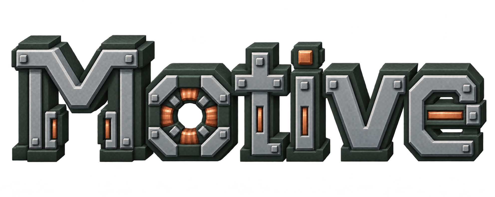
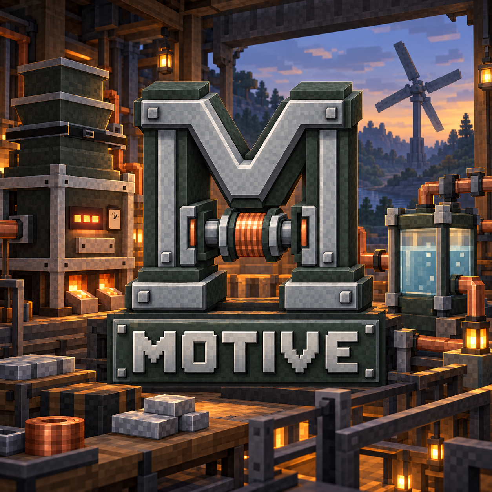

**Making energy and technology-driven power visualizable.**

A technology mod for Minecraft Java Edition.

[Releases](https://github.com/Motive-Dev-Studio/Motive-Release/releases) · [Report an Issue](https://github.com/Motive-Dev-Studio/Motive-Release/issues) · [Join Us](join_collaboration.md) · [License](LICENSE)

Development build · Last updated: 2026-11-07

## About

Motive adds electricity, mechanical power, and industrial processing. Build connected machines to generate and store energy, process resources, and transport materials.

- **Energy:** solar, lava, steam, and kinetic generation, with cables and energy storage.
- **Machinery:** crushing, washing, smelting, metal forming, cutting, and compression.
- **Networks:** transmission shafts, gears, conveyors, liquid pipes, and gas storage.
- **Resources and equipment:** ores, rubber processing, oil extraction and refining, powered tools, and powered armor.

Animated machine parts, gauges, and tank levels show equipment activity. Many machines support interaction directly with their models. Optional JEI integration provides machine recipe previews.

  

## Requirements

| Component | Required version |
| --- | --- |
| Minecraft Java Edition | 26.3 |
| NeoForge | 26.3.0.76 or newer for Minecraft 26.3 |
| Java | 25 or newer |
| JEI | Optional; must match Minecraft and NeoForge |

## Feedback

Use the [public issue tracker](https://github.com/Motive-Dev-Studio/Motive-Release/issues) for bugs and suggestions. For bugs, include the mod and game versions, reproduction steps, and relevant logs or screenshots. Check existing issues before submitting.

## Join us

Want to help test development previews, improve gameplay, support the community, or contribute localization? Read our [collaboration invitation and guidelines](join_collaboration.md) for participation terms and how to apply.

## Credits & license

Created by [BigFish520](https://github.com/BigFish520), with programming and collaboration by [yu1745](https://github.com/yu1745).

Motive is distributed under the [Motive Project License](LICENSE). Code, textures, and models have separate terms; models are All Rights Reserved. The English license text is authoritative.
