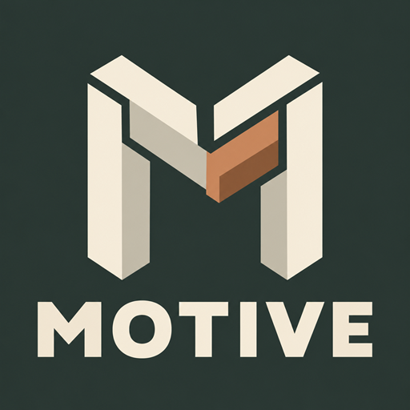

<div align="center">



# Join Us?

**Help shape Motive through thoughtful feedback, testing, and collaboration.**

[About Motive](README.md) · [Collaboration Email](mailto:motive_dev_studio@hotmail.com) · [Project License](LICENSE)

</div>

---

## How you can contribute

Interested in joining **Motive Dev Studio**? We welcome people who would like to help with:

- **Development previews and testing:** try available development builds, reproduce bugs, and help identify issues before release.
- **Gameplay and feedback:** explore new content and suggest practical improvements to the player experience.
- **Community operations:** help support and organize the community.
- **Localization and language support:** translate, review terminology, and help coordinate language maintenance.
- **Ideas and collaboration:** share a proposal, a useful perspective, or another way you would like to contribute.

Tell us what interests you and how you would like to help. Access to development previews and internal materials depends on your agreed role; applying does not automatically grant access or membership.

## Before you apply

> [!IMPORTANT]
> Collaboration is voluntary and unpaid. It does not entitle you to a salary, fees, a share of project revenue, or other financial compensation. Please apply only if you are comfortable with these terms.

### 1. Personal support and project fundraising

You may maintain your own Ko-fi page or receive support for your independent work. However, you must not solicit, collect, or accept money **in the name of Motive or Motive Dev Studio**, or present personal fundraising as official project fundraising.

This includes donations, sponsorships, paid access, sales, or other arrangements that imply you are collecting funds for, or on behalf of, the project or studio. Personal support pages must not imply official endorsement or affiliation beyond any role we have expressly confirmed.

### 2. Unreleased information and confidentiality

Do not publish, forward, distribute, or otherwise disclose non-public information about Motive or Motive Dev Studio unless it has already been officially released or you have explicit permission to share it.

This includes development builds, unreleased assets and features, screenshots or recordings of non-public content, internal discussions, and unannounced plans. Access for testing or collaboration is not permission to redistribute. Do not present unconfirmed information as an official statement.

### 3. Your work and official representation

You retain the copyright that belongs to you in the work you create and that the project adopts. The project's use and distribution of that work remain subject to the applicable license and any agreement made with you. Collaboration alone does not transfer ownership of the project or studio to you.

Authorship, credit, or a collaboration role does **not** authorize you to speak for Motive or Motive Dev Studio, issue official announcements, conduct publicity on our behalf, grant licenses or permissions, or make commitments for the project. Those activities require explicit authorization.

### 4. Acceptance and continued participation

By submitting a collaboration application, you confirm that you have read and agree to these guidelines. We will not approve an application if the applicant does not accept them. Applications are reviewed individually; submitting one does not guarantee acceptance.

These guidelines continue to apply throughout your participation. A violation will result in removal from the collaboration team. Leaving or being removed does not authorize disclosure of information that remains non-public, or continued use of an official role you no longer hold.

---

## Contact us

**Collaboration inquiries:** [motive_dev_studio@hotmail.com](mailto:motive_dev_studio@hotmail.com)

Please use a clear subject line and the application format below. A public name or alias is sufficient; please do not send passwords, access tokens, identity documents, or other sensitive personal information.

**Email subject**

```text
[Collaboration] Area of Interest — Your Name or Alias
```

**Email body**

```text
Hello Motive Dev Studio,

Name or alias:
Area(s) of interest:
Languages you can support:

Why I would like to join:
How I would like to contribute:
Relevant experience or examples of my work (optional):
General availability:

I have read and agree to the collaboration guidelines in join_collaboration.md.
I understand that participation is voluntary and unpaid.

Additional questions or information (optional):

Thank you,
Your name or alias
```

> [!NOTE]
> This mailbox is reserved for collaboration inquiries. Messages unrelated to collaboration will not receive a reply. Please submit ordinary bug reports and feature suggestions through the [public issue tracker](https://github.com/Motive-Dev-Studio/Motive-Release/issues).

Thank you for your interest and for taking the time to help improve Motive.

**Motive Dev Studio**

<sub>Current collaboration guidelines · Last updated: 2026-11-07</sub>
